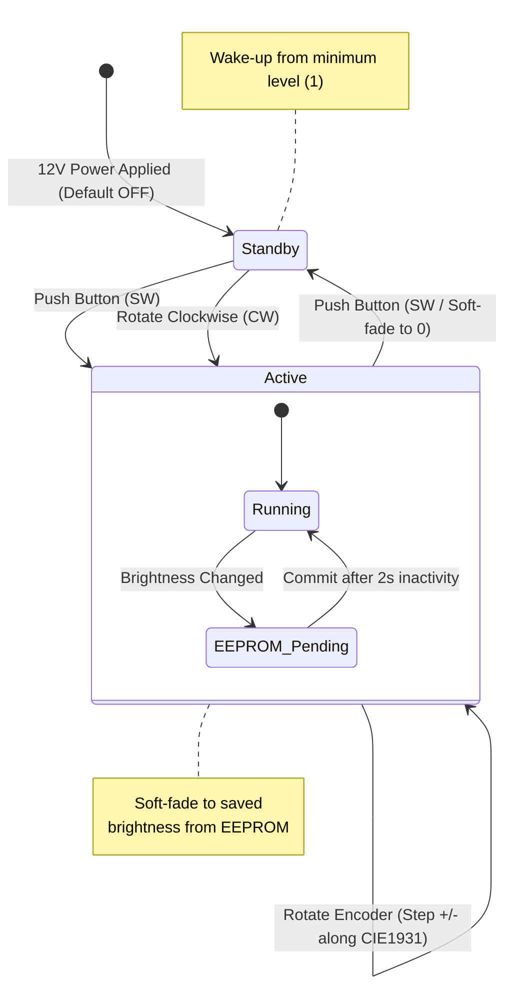

# MonitorLight — ATtiny85 Desk Lamp Controller

[](https://platformio.org/)
[-blue?logo=c)](https://www.microchip.com/)
[-lightgrey)](https://www.microchip.com/en-us/product/attiny85)
[](https://www.kicad.org/)
[](https://wokwi.com)

A compact, hardware desk lamp (screenbar) controller designed for monitor mounting. The project combines dedicated power regulation using a synchronous step-down converter, an incremental rotary encoder UI, and deterministic pure C firmware without Arduino runtime overhead.

---

## Key Features

* **Silent Power Stage (Fast PWM 31.25 kHz):** Operating well above the human audible spectrum (20 Hz – 20 kHz) eliminates inductor whine and ceramic capacitor piezo singing while avoiding camera sensor flicker.
* **Hardware Eye Perception (CIE 1931 Gamma Curve):** 32-step nonlinear lookup table stored in `PROGMEM` providing perceptually uniform brightness adjustments across the entire range.
* **True 0% PWM Standby:** Explicitly disconnects the timer output compare pin when turned off, eliminating residual sub-microsecond voltage spikes typical of AVR Fast PWM and preventing LED glow in standby.
* **Bounce-Immune Quadrature Decoding:** 16-state transition table state machine eliminates mechanical encoder bounce (EC11) without requiring external RC filter networks.
* **EEPROM Wear-Leveling Protection:** Current brightness level is committed to EEPROM only after 2 seconds of inactivity, drastically extending non-volatile cell endurance.
* **Soft-Fade Transition:** Smooth duty cycle ramping during power toggling and manual step adjustments.

---

## Hardware Architecture

| Component | Part / Value | Role in Circuit |
| :--- | :--- | :--- |
| **MCU** | `ATtiny85-20SU` (SOIC-8) | Main microcontroller (8 MHz internal, BOD 2.7V) |
| **Buck Regulator** | `AP63205WU-7` (TSOT-26) | Logic power rail: 12V → 5V (2A, 1.1 MHz) |
| **Switching MOSFET** | `IRLR024N` (TO-252) | Logic-level N-MOSFET Low-Side switch for 12V LED load |
| **Rotary Encoder** | `EC11E20-20P20C-SW` | User interface (20 PPR / 20 detents + momentary push button) |
| **Programming Port** | `J_ISP` (Pin Header) | Dedicated AVR ISP programming header |

### Pinout Configuration

```text
                  ┌───────[ ATtiny85 ]───────┐
      RESET (PB5) │ 1 [•]                  8 │ VCC (+5V AP63205)
   ENC_CLK  (PB3) │ 2                      7 │ PB2 (SCK / Unused)
   ENC_DT   (PB4) │ 3                      6 │ PB1 (ENC_SW - Pushbutton)
              GND │ 4                      5 │ PB0 (PWM -> MOSFET Gate)
                  └──────────────────────────┘
```

---

## Firmware State Machine



---

## Repository Structure

```text
MonitorLight/
├── MonitorLight.kicad_sch   # KiCad schematic
├── MonitorLight.kicad_pcb   # Single-layer PCB layout
├── MonitorLight.kicad_pro   # KiCad project file
├── MonitorLight_Code/       # Firmware directory (PlatformIO)
│   ├── src/
│   │   └── main.c           # Pure C firmware (AVR-GCC)
│   ├── diagram.json         # Wokwi simulation circuit configuration
│   ├── wokwi.toml           # Wokwi VS Code integration settings
│   └── platformio.ini       # PlatformIO build configuration & fuse settings
├── .gitignore               # Repository hygiene rules
└── README.md
```

---

## Getting Started & Simulation

### Prerequisites
* [Visual Studio Code](https://code.visualstudio.com/)
* **PlatformIO IDE** extension
* **Wokwi Simulator** extension

### Local Build and Simulation
1. Clone the repository:
   ```bash
   git clone [https://github.com/](https://github.com/)<your-username>/MonitorLight.git
   ```
2. Open the `MonitorLight_Code` directory in VS Code.
3. Build the binary:
   ```bash
   pio run
   ```
4. Open `diagram.json`, open the command palette (`F1`), and execute:
   ```text
   Wokwi: Start Simulator
   ```
   *Rotate the encoder with the mouse, test button presses, and inspect real-time signal waveforms in the generated `wokwi.vcd` trace using extensions like VaporView.*

---

## Hardware Flashing

Flashing the physical board requires a standard **USBasp** programmer connected to the `J_ISP` header:

1. Burn fuse bits (Internal 8 MHz oscillator, BOD enabled at 2.7V):
   ```bash
   pio run -t fuses
   ```
   * Target values: `lfuse: 0xE2`, `hfuse: 0xDD`, `efuse: 0xFF`
2. Upload firmware via ISP:
   ```bash
   pio run -t upload
   ```

---

## License

This project is licensed under the MIT License — see the `LICENSE` file for details.